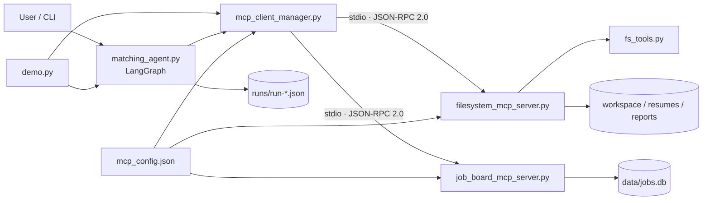
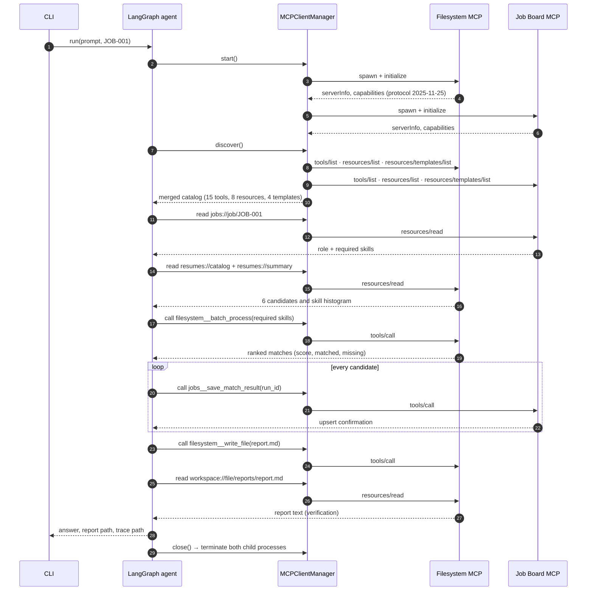
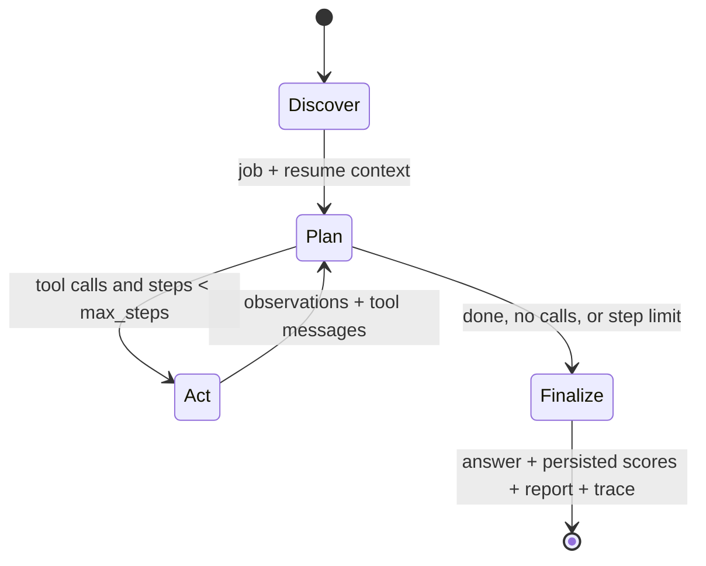

# Architecture — Milestone 2: Resume Matching over MCP

This document explains how the Milestone 1 file tools became two independent MCP
servers, how the LangGraph agent consumes them, and why the main design choices
were made.

## 1. Goals and constraints

| Goal | Implementation |
| --- | --- |
| Expose every Milestone 1 tool through MCP | `filesystem_mcp_server.py` exposes `read_file`, `list_files`, `write_file`, `search_in_file` plus `watch_directory`, `batch_process`, `get_config`, `get_stats` |
| Remove direct tool imports from the agent | `matching_agent.py` imports only `mcp_client_manager`; a test asserts it never imports `fs_tools` or either server module |
| JSON-RPC 2.0 protocol | Official Python MCP SDK 2.x owns the handshake, discovery, calls, resources and standard error codes |
| Resource discovery | Four static resources and two resource templates per server, advertised via `resources/list` and `resources/templates/list` |
| Configuration management | `mcp_config.json` + `mcp_config.py` with environment overrides, path normalisation and range validation |
| Bonus: multiple MCP servers | A second SQLite-backed `job_board_mcp_server.py`; one manager connects to both |
| Reproducible demo without an API key | `ScriptedPlanner` runs the same LangGraph/MCP workflow offline |

## 2. Component diagram



The agent has no filesystem, PDF, DOCX or SQLite code. The only coupling is the
MCP contract: tool schemas in, JSON results out.

## 3. One agent run, end to end



## 4. LangGraph state machine



State (`AgentState`):

| Field | Purpose |
| --- | --- |
| `prompt`, `job_id`, `run_id` | Request identity |
| `context` | Job, resume catalog and summary read as MCP resources |
| `messages` | LLM conversation (assistant tool calls + tool results) |
| `pending` | Tool calls chosen by the current plan |
| `observations` | Every executed MCP tool call, accumulated with `operator.add` |
| `events` | Discovery, plan, tool, persistence, report and verification events |
| `steps`, `max_steps`, `done` | Loop guards |
| `rankings`, `answer`, `report_path`, `persisted` | Final outputs |

`discover → plan → act → plan` is a real loop: the LLM sees each tool result and
can recover from errors, request more context, or stop. The offline planner uses
the same nodes and the same MCP calls.

## 5. MCP surface

### 5.1 Filesystem server — tools

| Tool | Type | Notes |
| --- | --- | --- |
| `read_file` | read | PDF/DOCX/TXT/MD text + metadata |
| `list_files` | read | Non-recursive listing, optional extension filter |
| `write_file` | write | Text only; refuses binary formats; creates parents |
| `search_in_file` | read | Case-insensitive phrase search with context |
| `watch_directory` | read/long-poll | Baseline/diff with `new`, `modified`, `removed` |
| `batch_process` | read | `metadata`, `read`, `search`, `skills`, `match`; bounded thread pool |
| `get_config` | read | Effective configuration and capabilities |
| `get_stats` | read | Counters, per-tool latency, watch state |

### 5.2 Filesystem server — resources

| URI | Kind | Content |
| --- | --- | --- |
| `resumes://catalog` | static | Resume file list with size/date |
| `resumes://summary` | static | Counts, words, skill frequency, per-candidate skills |
| `workspace://config` | static | Effective config (secret-free) |
| `workspace://stats` | static | Runtime counters and watch baselines |
| `resumes://file/{name}` | template | Extracted text of one resume |
| `workspace://file/{+path}` | template | Any supported workspace file; `{+path}` allows slashes |

### 5.3 Job board server — tools and resources

Tools: `search_jobs`, `get_job`, `save_match_result`, `list_match_results`,
`clear_match_results`, `get_config`, `get_stats`.

Resources: `jobs://catalog`, `jobs://matches`, `jobs://stats`, `jobs://config`,
`jobs://job/{job_id}`, `jobs://matches/{job_id}`.

SQLite schema:

```sql
jobs(id TEXT PRIMARY KEY, title, company, location, employment_type,
     min_experience, salary_range, description,
     required_skills TEXT, nice_to_have TEXT, created_at)

match_results(id INTEGER PRIMARY KEY AUTOINCREMENT,
              job_id, resume_name, score, matched_skills TEXT, run_id, created_at,
              UNIQUE(job_id, resume_name, run_id))
```

The unique key makes a rerun with the same `run_id` an update, not a duplicate.
Every query is parameterised; there is no tool that executes arbitrary SQL.

### 5.4 Protocol methods exercised

| Method | Direction | Purpose |
| --- | --- | --- |
| `initialize` | client → server | Version/capability negotiation |
| `notifications/initialized` | client → server | Handshake completion |
| `tools/list` | client → server | OpenAI/function schemas |
| `tools/call` | client → server | Execute an action |
| `resources/list` | client → server | Static resource discovery |
| `resources/templates/list` | client → server | URI-template discovery |
| `resources/read` | client → server | Fetch context |

Standard errors:

| Case | Response |
| --- | --- |
| Unknown method | JSON-RPC `-32601 Method not found` |
| Invalid request parameters / unknown resource | JSON-RPC `-32602` |
| Expected tool failure (missing file, bad score, unsupported type) | `tools/call` result with `isError: true` and a JSON payload |
| Unexpected server exception | JSON-RPC `-32603` (SDK) |

Tool failures intentionally use in-band `isError: true` so the model can read the
structured `error_code` and recover. The client manager normalises both kinds
into `ToolCallResult(ok=..., error=...)`.

## 6. Configuration

Precedence, lowest to highest:

1. `DEFAULTS` in `mcp_config.py`
2. `mcp_config.json` (or `MCP_CONFIG`)
3. Environment: `MCP_WORKSPACE` / `WORKSPACE_DIR`, `MCP_LOG_LEVEL`,
   `MCP_CONCURRENCY`, `MCP_MAX_BATCH_FILES`, `MCP_MAX_FILE_MB`,
   `MCP_WATCH_POLL`, `MCP_CLIENT_TIMEOUT`, `JOBS_DB`, `GROQ_MODEL`
4. Explicit `overrides` passed to `load_config()`

The loader resolves all paths to absolute paths, normalises extensions, creates
the workspace, validates ranges (concurrency 1–32, timeout > 0, etc.) and builds
absolute stdio launch specs. Servers inherit `MCP_WORKSPACE`, `MCP_CONFIG` and
`JOBS_DB`, so a child process sees the same configuration as its parent.

## 7. Security and resource limits

- **Sandbox**: every path is `resolve()`d and must be `is_relative_to(workspace)`.
  Traversal (`../secret`) is rejected before any read.
- **Symlinks**: skipped during directory walks so a link cannot escape the sandbox.
- **Size**: reads are capped by `workspace.max_file_bytes` (default 20 MB).
- **Writes**: binary extensions are refused; only text is written.
- **Batch**: `batch.max_files` and `batch.concurrency` bound CPU/memory; each file
  is parsed once even when several operations are requested.
- **Watch**: poll interval and maximum wait are configurable; state is in-memory
  per server process, so restarting the server resets baselines.
- **Jobs DB**: parameterised SQL, score range 0–100, `run_id` required, no raw SQL tool.
- **Secrets**: `.env` is git-ignored; resources expose `public_config`, which strips
  `_meta` and server `env` blocks.

## 8. Design decisions and trade-offs

| Decision | Why | Trade-off |
| --- | --- | --- |
| Official MCP SDK instead of hand-rolled JSON-RPC | Correct negotiation, schemas, cancellation and error codes for free | Less control over parse-error behaviour at the transport layer |
| stdio by default, `streamable-http` optional | Child processes are easy to sandbox and need no ports; HTTP is available for deployment | stdio is local-only |
| Tools for actions, resources for context | Follows MCP semantics; resources are cheap to discover and read | Two APIs for the agent to learn |
| `server__tool` names | Prevents collisions when many servers are connected and stays OpenAI-safe | Slightly verbose in traces |
| Tool errors as `isError` payloads | The model can recover; the client still sees a standard failure flag | Callers must parse JSON error text |
| Scores in a second server | Proves the multi-MCP bonus and keeps the filesystem server stateless | One more process to start |
| Deterministic offline planner | Demos/tests run with no API key and produce identical rankings | It is not a general natural-language planner |
| Report written through MCP | The agent never touches the filesystem directly | Report write depends on the filesystem server being healthy |
| Trace files written directly | Orchestration logs are local concerns, not workspace content | A strict reviewer could argue the trace should also be a resource |

## 9. Extension points

- Add a third server (web search, calendar, database) by adding a `servers` entry
  and restarting; `MCPClientManager` discovers it automatically and
  `openai_tools()` includes its tools.
- Add a tool by decorating a method in the server and calling `_add_tool`; schemas
  are generated from type hints and docstrings.
- Replace `ScriptedPlanner` with any planner that returns `PlannerDecision`.
- Swap `stdio` for `streamable-http` per server with a transport-aware manager.

## 10. Related documents

- [README.md](README.md) — setup, commands, project map
- [TEST_SCENARIOS.md](TEST_SCENARIOS.md) — automated and manual test cases
- [DEMO_SCRIPT.md](DEMO_SCRIPT.md) — timed 5–6 minute demo
